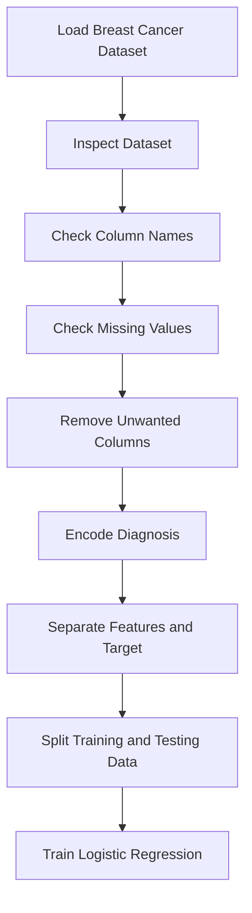
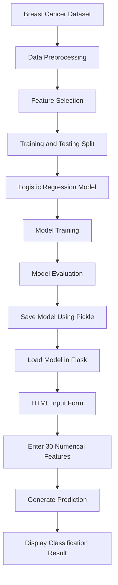
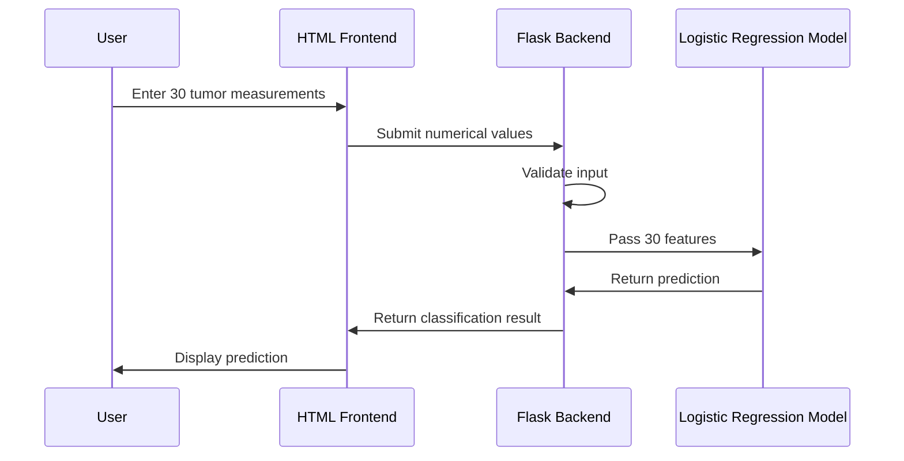

# 🩺 Breast Cancer Prediction Using Logistic Regression

### A Machine Learning Binary Classification Project

---

## 📌 Project Overview

This project demonstrates the implementation of a **Logistic Regression Machine Learning algorithm** for binary classification using the Breast Cancer Wisconsin Diagnostic Dataset.

The project includes:

* Machine Learning model development using Python.
* Object-Oriented Programming (OOP) implementation.
* Model training and testing.
* Model evaluation using classification metrics.
* Model serialization using Pickle.
* Flask-based web application.
* Interactive HTML frontend.
* Tumor measurement input form.
* Random numerical value generation.
* Real-time model-based predictions.

The application accepts 30 numerical tumor measurement features and passes them to a trained Logistic Regression model to generate a binary classification prediction.

The project is designed for educational purposes to understand how a Machine Learning algorithm can be integrated into a web application.

---

## 🎯 Project Objectives

The main objectives of this project are:

1. Understand the Logistic Regression algorithm.
2. Implement binary classification using Scikit-learn.
3. Perform data preprocessing and feature selection.
4. Train and evaluate a Machine Learning model.
5. Save and load a trained model using Pickle.
6. Develop a web application using Flask.
7. Connect a Machine Learning model with an HTML frontend.
8. Understand the complete Machine Learning development workflow.

---

## 📸 Application Screenshots

The following screenshots demonstrate the working application.

### 1. Application Homepage

The homepage displays the project title, Logistic Regression algorithm information, classification type, and tumor measurement input form.

### 2. Tumor Measurement Input Form

The application provides 30 numerical input fields divided into three categories:

* Mean Features
* Standard Error Features
* Worst Features

Users can enter numerical values manually or use the Random Values button to populate the fields.

### 3. Model Prediction Result

After submitting the numerical measurements, the application displays the classification result generated by the trained Logistic Regression model.

The application also displays the model probability associated with the predicted class.

---

## 🧠 Machine Learning Algorithm

### Logistic Regression

Logistic Regression is a supervised Machine Learning algorithm commonly used for binary classification problems.

Although its name contains the word regression, it is primarily used to predict the probability that an observation belongs to a particular class.

In this project, Logistic Regression is used to classify breast cancer tumor measurements into two categories.

### Binary Classification

The dataset contains two diagnosis categories:

| Diagnosis | Description | Encoded Value |
| --------- | ----------- | ------------- |
| M         | Malignant   | 0             |
| B         | Benign      | 1             |

The model learns the relationship between the 30 tumor measurement features and the diagnosis.

### Logistic Regression Equation

The Logistic Regression model calculates a linear combination of input features:

[
z = b + w_1x_1 + w_2x_2 + \cdots + w_nx_n
]

The calculated value is passed through the sigmoid function:

[
\sigma(z) = \frac{1}{1+e^{-z}}
]

The sigmoid function converts the output into a probability between 0 and 1.

The model then uses its classification threshold to determine the predicted class.

For the default Scikit-learn Logistic Regression classifier, the probability threshold is generally 0.5.

---

## 📊 Dataset Information

### Breast Cancer Wisconsin Diagnostic Dataset

This project uses the Breast Cancer Wisconsin Diagnostic Dataset.

The dataset contains numerical measurements extracted from breast tumor images.

Each observation represents a tumor sample.

The dataset contains:

| Attribute              | Description                                |
| ---------------------- | ------------------------------------------ |
| Dataset                | Breast Cancer Wisconsin Diagnostic Dataset |
| Problem Type           | Binary Classification                      |
| Target Variable        | Diagnosis                                  |
| Input Features         | 30                                         |
| Total Original Columns | 32                                         |
| Unwanted Columns       | `id`, `Unnamed: 32`                        |
| Algorithm              | Logistic Regression                        |
| Library                | Scikit-learn                               |

### Dataset Features

The dataset contains 30 numerical features divided into three groups.

#### 1. Mean Features

These features represent the average measurements of the tumor.

* Radius Mean
* Texture Mean
* Perimeter Mean
* Area Mean
* Smoothness Mean
* Compactness Mean
* Concavity Mean
* Concave Points Mean
* Symmetry Mean
* Fractal Dimension Mean

#### 2. Standard Error Features

These features represent the standard error of the corresponding measurements.

* Radius SE
* Texture SE
* Perimeter SE
* Area SE
* Smoothness SE
* Compactness SE
* Concavity SE
* Concave Points SE
* Symmetry SE
* Fractal Dimension SE

#### 3. Worst Features

These features represent the largest or worst measurements of the corresponding tumor characteristics.

* Radius Worst
* Texture Worst
* Perimeter Worst
* Area Worst
* Smoothness Worst
* Compactness Worst
* Concavity Worst
* Concave Points Worst
* Symmetry Worst
* Fractal Dimension Worst

---

## 🔍 Exploratory Data Analysis (EDA)

Exploratory Data Analysis is performed to understand the structure, characteristics, and quality of the dataset before training the model.

### EDA Workflow



### 1. Dataset Inspection

The dataset is loaded using Pandas.

```python
import pandas as pd

df = pd.read_csv("breast_cancer_dataset.csv")

print(df.head())

print(df.shape)

print(df.info())

print(df.describe())
```

This helps us understand:

* Dataset structure
* Number of observations
* Number of features
* Data types
* Statistical distribution of numerical columns

### 2. Removing Unwanted Columns

The dataset contains two unwanted columns:

```python
df = df.drop(
    ["id", "Unnamed: 32"],
    axis=1
)
```

The `id` column is an identifier and does not provide useful tumor measurement information.

The `Unnamed: 32` column is an unnecessary column in this dataset.

### 3. Diagnosis Encoding

The diagnosis column contains text values.

The values are converted into numerical values.

```python
df["diagnosis"] = df["diagnosis"].map({
    "M": 0,
    "B": 1
}).astype(int)
```

This allows the classification algorithm to process the target variable numerically.

### 4. Feature and Target Separation

The independent variables are stored in `X`.

The dependent variable is stored in `y`.

```python
X = df.iloc[:, 1:]

y = df.iloc[:, 0]
```

### 5. Training and Testing Data

The dataset is divided into training and testing datasets.

```python
from sklearn.model_selection import train_test_split

x_train, x_test, y_train, y_test = train_test_split(
    X,
    y,
    test_size=0.2,
    random_state=42
)
```

The training dataset is used to train the model.

The testing dataset is used to evaluate its performance on unseen observations.

---

## ⚙️ Machine Learning Workflow

The complete Machine Learning workflow is represented below.



### Workflow Explanation

1. Load the Breast Cancer dataset.
2. Remove unwanted columns.
3. Convert diagnosis values into numerical values.
4. Separate input features and target variable.
5. Split the dataset into training and testing data.
6. Train the Logistic Regression model.
7. Evaluate model performance.
8. Save the trained model using Pickle.
9. Load the model into the Flask application.
10. Accept numerical inputs from the user.
11. Generate the prediction.
12. Display the classification result.

---

## 📈 Model Evaluation

The Logistic Regression model is evaluated using the following metrics.

### 1. Confusion Matrix

A confusion matrix compares the actual classifications with the predicted classifications.

For this project:

|                  | Predicted Malignant | Predicted Benign |
| ---------------- | ------------------- | ---------------- |
| Actual Malignant | True Negative       | False Positive   |
| Actual Benign    | False Negative      | True Positive    |

Because the target encoding is:

* Malignant = 0
* Benign = 1

The confusion matrix follows the class order `[0, 1]`.

### 2. Accuracy Score

Accuracy measures the percentage of correctly classified observations.

[
Accuracy = \frac{Correct\ Predictions}{Total\ Predictions}
]

Python implementation:

```python
from sklearn.metrics import accuracy_score

accuracy = accuracy_score(
    y_test,
    test_predict
)

print(accuracy)
```

### 3. Classification Report

The classification report provides:

* Precision
* Recall
* F1-score
* Support

```python
from sklearn.metrics import classification_report

print(
    classification_report(
        y_test,
        test_predict
    )
)
```

These metrics help evaluate the performance of the trained model.

**Note:** Actual performance values depend on the trained model, dataset, preprocessing, and train-test split. No fixed accuracy value is assumed in this README.

---

## 💾 Model Serialization Using Pickle

After training, the Logistic Regression model is saved using Pickle.

```python
import pickle

with open(
    "Logistic_Regression_Binary.pkl",
    "wb"
) as f:

    pickle.dump(reg, f)
```

The saved model can be loaded later.

```python
with open(
    "Logistic_Regression_Binary.pkl",
    "rb"
) as p:

    model = pickle.load(p)
```

This allows the Flask application to use the trained model without training it again whenever the application starts.

### Important

Pickle files should only be loaded from trusted sources because loading an untrusted Pickle file can execute arbitrary code.

---

## 🌐 Flask Web Application

The project includes a Flask web application that connects the trained Machine Learning model with an HTML frontend.

### Frontend

The frontend is developed using:

* HTML
* CSS
* JavaScript

The application uses a modern dark-themed interface.

### Backend

The backend is developed using Flask.

The Flask application performs the following operations:

1. Loads the trained Logistic Regression model.
2. Displays the HTML input form.
3. Receives numerical values from the frontend.
4. Validates the input values.
5. Converts the input into the required numerical format.
6. Passes the values to the trained model.
7. Generates the classification prediction.
8. Returns the prediction result to the frontend.

### Prediction Process



---

## 🖥️ Application Features

### 1. Interactive Input Form

The application provides 30 numerical input fields.

Users can enter tumor measurement values manually.

### 2. Random Values Generation

The Random Values button generates numerical values and fills the input fields.

This feature is useful for testing the frontend and backend integration.

**Important:** Randomly generated values are only for demonstration and testing. They do not represent actual patient measurements.

### 3. Prediction Generation

The Generate Prediction button submits the numerical input values to the Flask backend.

The trained Logistic Regression model generates the classification result.

### 4. Reset Values

The Reset Values button clears the input fields.

### 5. Prediction Probability

The application displays the probability associated with the predicted class.

This probability is the model's estimated probability, not a medically validated assessment.

---

## 📁 Project Structure

The project repository is organized as follows:

```text
Logistic_Regression_Binary_Classification_Project/
│
├── .venv/
│
├── screenshots/
│   ├── Screenshot (812).png
│   ├── Screenshot (813).png
│   └── Screenshot (814).png
│
├── templates/
│   └── index.html
│
├── app.py
│
├── main.py
│
├── Logis_Regression_Binary_Explanation.py
│
├── Logistic_Regression_Binary.pkl
│
├── Logistic_Regression_Binary_Breast_Cancer.pkl
│
├── breast_cancer_dataset.csv
│
├── requirements.txt
│
└── README.md
```

### File Descriptions

| File                                           | Description                                             |
| ---------------------------------------------- | ------------------------------------------------------- |
| `app.py`                                       | Flask backend for the web application                   |
| `main.py`                                      | Logistic Regression implementation                      |
| `Logis_Regression_Binary_Explanation.py`       | Algorithm explanation and development code              |
| `index.html`                                   | Frontend interface                                      |
| `Logistic_Regression_Binary.pkl`               | Serialized Logistic Regression model                    |
| `Logistic_Regression_Binary_Breast_Cancer.pkl` | Saved model generated by the development implementation |
| `breast_cancer_dataset.csv`                    | Breast Cancer dataset                                   |
| `requirements.txt`                             | Python dependencies                                     |
| `screenshots/`                                 | Application screenshots                                 |
| `README.md`                                    | Project documentation                                   |

---

## 🚀 Installation and Setup

Follow these steps to run the project locally.

### Step 1: Clone the Repository

```bash
git clone YOUR_GITHUB_REPOSITORY_URL
```

Replace `YOUR_GITHUB_REPOSITORY_URL` with your actual GitHub repository URL.

### Step 2: Navigate to the Project Folder

```bash
cd Logistic_Regression_Binary_Classification_Project
```

### Step 3: Create a Virtual Environment

```bash
python -m venv .venv
```

### Step 4: Activate the Virtual Environment

For Windows PowerShell:

```powershell
.\.venv\Scripts\Activate.ps1
```

For Windows Command Prompt:

```cmd
.venv\Scripts\activate
```

### Step 5: Install Dependencies

```bash
pip install -r requirements.txt
```

### Step 6: Run the Flask Application

```bash
python app.py
```

### Step 7: Open the Application

Open your browser and navigate to:

```text
http://127.0.0.1:5000
```

The application will display the Breast Cancer Prediction interface.

---

## 🛠️ Technologies Used

| Technology   | Purpose                            |
| ------------ | ---------------------------------- |
| Python       | Programming language               |
| Pandas       | Data preprocessing                 |
| NumPy        | Numerical operations               |
| Scikit-learn | Logistic Regression and evaluation |
| Flask        | Web application backend            |
| HTML         | Frontend structure                 |
| CSS          | Frontend styling                   |
| JavaScript   | Interactive frontend functionality |
| Pickle       | Model serialization                |
| Git          | Version control                    |
| GitHub       | Project repository                 |

---

## 🔮 Future Improvements

The following improvements can be considered in future versions:

* Add more exploratory data analysis visualizations.
* Add a feature correlation heatmap.
* Implement feature scaling using a Pipeline.
* Compare Logistic Regression with other classification algorithms.
* Add cross-validation.
* Improve model evaluation and validation.
* Add automated input validation.
* Add unit testing for the Flask application.
* Improve the user interface and accessibility.
* Deploy the application to a cloud platform.
* Add model versioning and reproducibility.

---

## 👨‍💻 Developer

**Developed by M. Yuva Teja**

Machine Learning Project

Algorithm: Logistic Regression

Problem Type: Binary Classification

Application: Breast Cancer Prediction

---

## ⚠️ Medical Disclaimer

This project is developed for educational and demonstration purposes only.

The predictions generated by this application are based on a Machine Learning model and must not be considered medical diagnoses.

This application is not a medical diagnostic tool.

The model's predictions are not a substitute for professional medical advice, diagnosis, or treatment.

Always consult a qualified healthcare professional for medical concerns.

---

## ⭐ Support

If you find this project useful for learning Machine Learning, Python, Flask, or Logistic Regression, consider giving the repository a star on GitHub.

Thank you for visiting this project!
